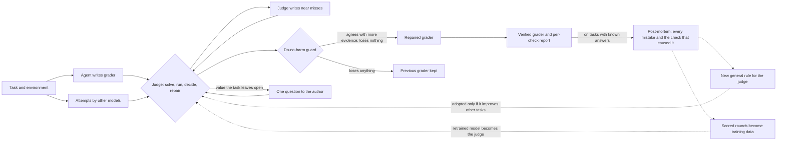
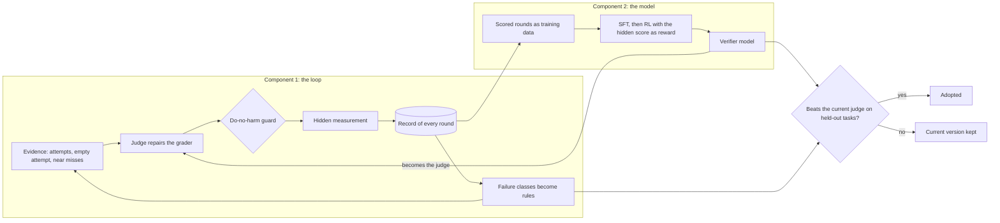

*Verifier Bench research program · report to HUD · 14 October 2026*

# The Verify Loop and the Verifier Model

HUD can now turn an agent-written grader into a correct one without a human, using any frontier model as the judge. The models are interchangeable and improve for everyone. What makes the result work is the loop around the model: its evidence, its do-no-harm guard, its hidden measurement and the failure data it accumulates. That loop is ours to own, and it is what trains a dedicated verifier model that makes the whole system cheap, fast and independent.

Anil Kumar · every number below was measured on hidden, labelled attempts the judge never saw, and every study was pre-registered with its pass bar before it ran. The research log with every run is in [`loop/docs/research_intent_goal.md`](loop/docs/research_intent_goal.md); code and weights are in this repository.

## Summary

**The problem.** Graders are the reward signal of every RL environment. When a coding agent writes one, it carries almost no information: across 70 agent-written graders on Terminal-Bench 4.0 the mean balanced accuracy was 0.50 to 0.52, where 0.50 is a coin flip. Nine ways of helping the writer from the inside (intent steps, deriving the answer twice, property checks, self-made near misses) all stayed at chance. Only evidence from outside the writer moved it.

**What we built.** A harness that scores any grader on real labelled attempts; a **verify loop** in which a judge model audits and repairs a grader inside the task's own machine, using outside attempts, near misses and a mechanical do-no-harm guard; and a ladder of models, from a 116M judge trained from scratch to an open 27B model running the whole loop on our own GPUs at zero API cost.

**What it proved.**

- **The loop works with a frontier judge.** On seven agent-written graders it reached 1.00 on five, from starting points of 0.35, 0.45, 0.50, 0.50 and 0.85. The mean of the first six went from 0.71 to 0.90, and no correct attempt was newly rejected anywhere.
- **It is model-agnostic.** The judge is a configuration value: Anthropic's API, Claude Code, any model on OpenRouter, or our own GPUs. Measured with Claude Opus and with an open 27B model, which untrained already reaches 0.82 against the frontier judge's 0.90 on held-out tasks.
- **It improves as a system.** It has two components, the loop and the model, and each one's output is the other's input. Every failure the loop meets becomes a rule that closes its whole class, every round it runs becomes a scored training example for the model, and a change to either is adopted only when it beats the current one on tasks it has never seen. The self-evolving step is built and its first cycle has run: it found every mistake on three labelled tasks by itself and proposed six general rules (section 8).

**What we ask for.** Every training run so far used free data: small public task sets, puzzles, the model's own attempts and $34 of frontier demonstrations. Those runs located the model's gap exactly. The next stage needs real labelled attempts at scale (8,910 are already indexed for Terminal-Bench 4.0 alone) and **64 H100 GPUs for 6 days** for outcome-based reinforcement learning on the loop itself. Section 14 lists the full to-do list to the goal.

| **0.51** | **5 of 7** | **0 of 5** | **8,910** |
|---|---|---|---|
| agent-written graders on their own, mean balanced accuracy (chance is 0.50) | graders taken to 1.00 by the loop with a frontier judge | graders left below their starting score by the loop under judges v2 and v3 | graded leaderboard attempts indexed for the next stage |

### Contents

1. [The problem, measured](#1-the-problem-measured)
2. [How a grader is measured](#2-how-a-grader-is-measured)
3. [The verify loop](#3-the-verify-loop)
4. [What the loop has done](#4-what-the-loop-has-done)
5. [Autonomous graders with any frontier model](#5-autonomous-graders-with-any-frontier-model)
6. [Why continuous evaluation, not a fixed rulebook](#6-why-continuous-evaluation-not-a-fixed-rulebook)
7. [Why the loop is the asset](#7-why-the-loop-is-the-asset)
8. [Two components, one loop](#8-two-components-one-loop)
9. [How fast it improves](#9-how-fast-it-improves)
10. [The models we built](#10-the-models-we-built)
11. [The training program](#11-the-training-program)
12. [Why an untrained model trails the frontier](#12-why-an-untrained-model-trails-the-frontier)
13. [Why our own model](#13-why-our-own-model)
14. [The to-do list to the goal](#14-the-to-do-list-to-the-goal)
15. [Resources](#15-resources)
16. [I can build this](#16-i-can-build-this)

## 1. The problem, measured

We benchmarked graders written by agents (Claude Sonnet 5 and GPT-6 Luna, through Claude Code, Terminus and Codex) for four Terminal-Bench 4.0 tasks, each scored on about 21 real leaderboard attempts whose labels we re-checked with the official tests. Then we tested nine ways of helping the writer, three rollouts each.

| Method | Mean balanced accuracy |
|---|---|
| Writer alone (task and machine only) | 0.52 |
| Intent step, narrow and full | 0.51 |
| Derive the answer twice, assert only what agrees | 0.50 |
| Derive twice plus self-made near misses | 0.51 |
| Check properties instead of values | 0.51 |
| **Other models' unlabelled attempts** (5, some wrong) | **0.80** |
| **A correct reference solution** | **0.83** |
| **Reference plus intent step** | **0.88** |

A writer understands what a task is for; it cannot work out on its own what a correct result concretely looks like. Outside evidence fixes that even when most of it is wrong: on production-planning only 2 of 5 outside attempts were correct, and every writer that saw them still built a grader that accepts all 11 correct plans, where every baseline grader accepted none. The verify loop is built on that finding.

## 2. How a grader is measured

A grader is never judged by reading it. It runs on real attempts whose verdict is known, inside the same sandbox the real grader uses, and is scored by balanced accuracy:

TPR = P(pass | correct)    TNR = P(fail | wrong)    BA = (TPR + TNR) / 2    reward = max(0, 2·BA − 1)

A grader that passes everything, fails everything or flips a coin scores exactly 0.50. We built this both as a HUD taskset (writing the grader is the task; a hidden grader runs the agent's tests on stored attempts) and as a local Docker harness with identical scoring. Controls: official tests score 1.00; always-pass, always-fail, no grader and a grader built to cheat all score 0. The hidden pool is never shown to any model in the loop, so a score on it is an honest test.

## 3. The verify loop

A judge model works inside the task's own machine with a shell. Each round:

1. **Gather evidence.** Five attempts by other models (unlabelled, some wrong), an attempt that did nothing, and near misses the judge writes, each breaking exactly one requirement.
2. **Solve the task independently** where it can, so it knows what a correct result looks like before judging anything.
3. **Run the grader exactly as the real grader runs** on every piece of evidence, and read its real output.
4. **Decide every disagreement** from the task's text, its own examples and its own data, and trace each check to the requirement it enforces.
5. **Repair the grader**, then pass the **do-no-harm guard**: on the same evidence the new grader must agree with the judge's verdicts on more items and on none fewer, or the old grader is restored. The guard is code, not judgement.
6. **Ask the author** one multiple-choice question, at most three per run, only when a value cannot be decided from the task.
7. **Report** every check with its basis: task text, recomputed, task example, author answer or contested.

The dotted path is the recursive part: after a run on a task with known answers, the loop finds its own mistakes, turns them into rules and training data, and feeds both back into the next run (section 8). The judge's instructions went through five tested versions, each closing a failure we had measured: v1 forbids changing an expected value the task does not settle; v2 settles a contested value only by an out-of-sample test on the task's own data, and adds the guard; v3 admits exactly one cited field-standard model; v4 adds author questions and the task's own examples as test cases.

## 4. What the loop has done

| Agent-written grader | Before | After | What the judge found |
|---|---|---|---|
| hof-topology-interpenetration | 0.35 | **1.00** | a misreading of the topology |
| roy-polymorph-cn, with author answers | 0.45 | **1.00** | two questions settled what the text left open |
| layout-config-recreation2 | 0.50 | **1.00** | a font list missing on the machine where the grader runs |
| mp-checkpoint-consolidation | 0.85 | **1.00** | "identical" traced to an exact comparison |
| photonic-waveguide-routing | 0.77 | **0.95** | a cost bar tighter than the task, relaxed with no correct attempt lost |
| production-planning | 0.50 | 0.70 | a rule that rejected every correct plan; still too loose on wrong plans |
| music-harmony, with the task's examples | 0.50 | 0.63 | false rejections removed (TPR 0.00 to 0.86) |

Five of seven reached 1.00. On the six graders of the first study the mean rose from **0.71 to 0.90**, and under judges v2 and v3, 0 of 5 graders ended below their starting score. The two that did not reach 0.90 share a cause: the evidence in front of the judge could not separate the remaining right and wrong work. That is the exact capability the next two sections are about.

## 5. Autonomous graders with any frontier model

Today every agent-written grader needs a human reviewer, because a broken grader and a working one look the same on the page. With the loop, that review step becomes a machine step:

- **The judge is pluggable.** The same loop runs on Anthropic's API, on Claude Code, on any model available through OpenRouter (OpenAI, Google and others, with no code change) and on open models served on our own GPUs. Measured so far with Claude Opus and with Qwen 3.8 27B.
- **No labels are needed at run time.** The loop builds its evidence from other models' attempts and its own near misses, so it runs on brand-new tasks.
- **It does not leave graders worse.** The guard restores the previous grader whenever a repair loses agreement with the evidence: under judges v2 and v3, 0 of 5 graders ended below their starting score.
- **A person is asked only what no model can know**: an author's own choice the task leaves open, as one multiple-choice question.
- **Every verdict is auditable** through the per-check report.

> **The consequence for HUD**
>
> HUD can make graders autonomously today, with whichever frontier lab's model is best this quarter. The judge is the replaceable part. The loop decides whether that judge's work is kept, measures it on attempts the judge never sees, and records every failure and fix.
>

## 6. Why continuous evaluation, not a fixed rulebook

The obvious alternative to a loop is a deterministic one: write down, once, the rules a good grader must satisfy and check every grader against them. We tested the ingredients of that approach and it does not survive real environments.

- **It is circular.** To check a grader deterministically you must already know what a correct result looks like for that task, and knowing that is the grader's whole job. Our fixed procedures inside the writer (deriving the answer twice, checking properties, self-made near misses) all stayed at 0.50 to 0.51. A rule applied without fresh evidence cannot discover what correct means.
- **Correctness has no fixed shape.** The tasks the loop has run on range from production planning and photonic routing to framework topology, music harmony and formal proofs. Each defines correct differently: an exact value, a tolerance, a range the author left open, a property of a file's structure. A rulebook general enough to cover them says nothing concrete; one concrete enough to help covers a single task.
- **New failure classes keep appearing.** Every class we found came from running the loop on a new task, not from design: a grader that needed a font list missing on the grading machine, a value the task never settled, a check tighter than the task's own wording. A rulebook written today covers only the classes already seen, and is silently wrong on the next one.
- **Environments change.** Dependencies, data and task text are updated. A grader verified once can break later with no sign of it, so verification has to rerun whenever the environment changes.
- **The policies being trained change.** A model trained against a grader searches for whatever the grader lets through. A fixed check is a fixed target: once a policy learns to satisfy it without doing the work, it pays out reward for wrong behaviour indefinitely. Continuous evaluation keeps adding new attempts, including adversarial ones, so a newly discovered exploit is caught the next time the grader is measured.
- **Many tasks leave decisions open.** A deterministic rule must either pick one reading, wrong for every author who meant the other, or skip the check. The loop keeps an open value contested or asks the author one question.
- **A rulebook still has to be measured.** Nobody can tell a working checker from a broken one by reading it, any more than a grader. Knowing whether the rules work requires labelled attempts and a hidden score, which is continuous evaluation under another name.

|   | Fixed rulebook | Continuous evaluation (the loop) |
|---|---|---|
| Knows what correct looks like | only if written into the rule in advance | works it out from the task, its data and real attempts, every time |
| New kind of task | uncovered until someone writes new rules | handled by the same procedure |
| New failure class | silently wrong | shows up in the hidden measurement and becomes a rule |
| Environment or policy changes | keeps paying out on the old assumption | re-verified against new attempts |
| Open decisions | picks one reading or skips the check | keeps it contested or asks the author |
| Evidence it works | none without separate measurement | a balanced accuracy on hidden attempts, every round |

Determinism is kept where the decision is mechanical: the guard, the scoring and the controls are fixed code, and a repaired grader is ordinary deterministic tests. Judgement, the part that needs to understand a new task, is learned and measured continuously. That split is what makes the system both reliable and general.

## 7. Why the loop is the asset

Frontier models are sold to everyone and improve for everyone. If grader quality depended only on the model, HUD's graders would be exactly as good as anyone else's who bought the same API. What makes the loop's numbers possible is the system around the model, and every part of it is in-house:

| Component | What it does | Why it is hard to copy |
|---|---|---|
| Evidence pipeline | harvests real attempts by many models from leaderboards and rollouts, regrades their labels, builds outside candidates, empty attempts and near misses per task | needs the environments, the attempts and the regrading infrastructure; HUD has all three at scale |
| Do-no-harm guard | keeps a repair only if it agrees with more evidence and loses nothing | the reason the loop never made a grader worse; naive loops routinely do |
| Hidden measurement | scores every grader on labelled attempts no model in the loop sees | turns "seems better" into a number; without it no one knows whether their loop works |
| Failure-class rules | judge versions v1 to v4, each closing a measured class of mistake | each rule was paid for by a failed run; the list only grows by running the loop |
| Failure and repair record | every round's transcript, verdicts, guard counts and hidden score | the training data for a dedicated verifier; it exists only if you run the loop at scale |
| Verifier model | an owned judge trained on that record | weights trained on data no one else has |

The success of the system therefore depends on what HUD runs and keeps, not on what a lab ships. Every task HUD verifies makes the loop's rules sharper and the model's training set larger, and none of that leaves HUD.

## 8. Two components, one loop

The system has two components that improve each other. Keeping them separate is what lets each one be improved, measured and replaced on its own.

|   | Component 1: the loop | Component 2: the model |
|---|---|---|
| What it is | the procedure: evidence, the judge's steps, the do-no-harm guard, author questions, the hidden measurement and the record of every round | the judge inside the loop: any frontier model today, HUD's own verifier model next |
| What it decides | which evidence the judge sees, which repairs are kept, what counts as success | what a correct result looks like, which attempts are right, how to repair the grader |
| How it improves | each measured failure becomes a rule or guard change that closes its whole class | trained on the loop's scored rounds: supervised on repairs that raised the hidden score, then reinforcement learning with the hidden score as the reward |
| What it hands the other | every round as a scored training example: the transcript, the repair and its score on attempts the judge never saw | better verdicts and repairs, which surface the next, harder failures for the loop to close |
| Already built | judges v1 to v4, the guard, the hidden-pool harness, the round record | serving and training stack for an open 27B judge running the whole loop at $0 API |

### Why it improves correctly

The guard that protects a single grader is applied to the system itself. A new rule in the loop, or a new version of the model, is adopted only if it raises balanced accuracy on held-out tasks it was never developed or trained on, and lowers no task below the current version. Otherwise the current version stays. The system can therefore only move forward on measured ground, the same way the loop never leaves a grader worse than it found it.

### How the two improve at the same time

1. **The loop runs** on HUD's environments with the best available judge and verifies their graders.
2. **Every round is recorded and scored** on hidden labelled attempts, so each one is a training example with a known reward.
3. **Failures are mined from the record:** where a kept repair still loses on the hidden pool, the failing check is traced to a class (a value the task never fixed, a file missing on the grading machine, a free-form check no evidence exercised) and a rule or evidence change is written for it.
4. **The model trains on the same record**, so it learns the decisions the rules were written for, not only the rules.
5. **Both changes go through the held-out gate**, and whichever passes is adopted.
6. **The better loop and model run on more environments**, which produces more and harder rounds, and the cycle repeats.

> **Built, and its first cycle has run**
>
> The self-evolving step is code (`loop/vb/evolve.py`), not a plan. On its first three tasks with known answers it ran without a person in the loop:
>
> - **Post-mortem:** it reran each final grader on every labelled attempt and found all 22 mistakes the graders made (7, 4 and 11), each with the check that misfired, reproducing the hidden scores exactly.
> - **Proposal:** a model turned those mistakes into 6 general rules for the judge, and all 6 passed the lint that rejects anything naming a task, a path or a value. Two of them: *"Never let a criterion fail an attempt because the evidence needed to judge it could not be found"* and *"Never derive a threshold from the attempts under audit by placing it just outside their observed values."*
> - **Rulebook and ledger:** the 6 rules are versioned candidates in `loop/configs/rulebook.json`, and every step is recorded in `loop/runs/evolve/ledger.jsonl`.
> - **Next:** the gate, paired runs on fresh labelled tasks, decides which rules are adopted. Until a rule passes it, the judge does not use it.

The model's half of the cycle uses the training stack already built (section 11). Training it at scale on the loop's record is items 17 to 22 of the to-do list.

## 9. How fast it improves

The loop's record shows a pattern: each measured failure becomes a rule or a component change that closes its whole class, and the gain shows up on the next tasks.

| Failure measured | Change made | Effect |
|---|---|---|
| Judges overwrote expected values the task never settled | judge v1 and v2: contested values settled only by out-of-sample tests; the guard | 0 of 5 graders ended below their start |
| A grader needed a font list missing on the grading machine | run the grader exactly where the real grader runs | layout-config-recreation2 0.50 to 1.00 |
| Values the task leaves to its author | judge v4: one multiple-choice question to the author | roy-polymorph-cn 0.45 to 1.00 |
| The open model lost track of its own earlier output | keep every command and output in context, drop old reasoning | 27B on production-planning 0.50 to 0.65 in 3 of 3 runs, the first movement in 18 runs |

Two compounding effects follow:

- **The loop improves with every failure it meets.** A fix lands in the instructions or the guard and applies to every later task with any judge, frontier or ours.
- **The model improves with every task the loop runs.** Each round is a fully scored training example: the transcript, the repair and its hidden-pool score. Run on HUD's environments, the loop produces thousands of these as a by-product of verifying graders. Our open model runs the loop at $0 API, so generating this data costs only GPU time.

That is the flywheel: the loop makes graders correct, every correction becomes training data, the trained verifier makes the loop cheaper and stronger, and the stronger loop verifies more environments.

## 10. The models we built

| Model | What it does | Training | What it established |
|---|---|---|---|
| Attempt judge, 116M, from scratch | reads an attempt and its test evidence, returns a verdict | Kimi Delta Attention hybrid, pretrained on 2.33B tokens on 4×H100 at about 531k tokens/s; our own MLX and PyTorch delta-rule kernels, matched to the reference within 1e-7 | balanced accuracy 0.96 to 0.97 on a held-out set; faked test output accepted 0% of the time. With no tests to read, AUC 0.53: evidence has to be created, which is the grader's job |
| Grader writer, 7B | writes the grader itself | Qwen2.5-Coder-7B, LoRA on 701 then 3,706 maintainers' test files, then reward-filtered | format solved (59 of 80 usable), accuracy 0.55 against Sonnet's 0.77: a writer cannot validate itself, so the product became a verifier next to any writer |
| Requirement model, 7B | lists what a correct grader must check | LoRA on teacher targets from 38 Terminal-Bench and 700 SWE-rebench tasks | 0.91 against 0.90 without it: the loop already finds requirements itself |
| Verdict model, 7B | reads an attempt's result files and predicts the official verdict | LoRA on 1,920 labelled attempts | 64% against the frontier judge's 77%: when correctness needs computation, reading is not enough |
| Open judge, Qwen 3.8 27B | runs the whole loop | served with vLLM on A100, H100 and 4×H100: FP8 weights and KV cache, prefix caching, LoRA serving, 262k context | untrained: 0.82 against the frontier judge's 0.90 on four held-out tasks, at $0 API |

Together these showed that the verifier cannot be split into reading-only models: it has to act in the environment, run things and build the computation a check needs. So the target became one model running the whole loop.

| Held-out task | Frontier judge | Open 27B, untrained (3 runs) |
|---|---|---|
| layout-config-recreation2 | 1.00 | 0.97 to 1.00 |
| mp-checkpoint-consolidation | 0.95 | 0.85 to 0.92 |
| photonic-waveguide-routing | 0.93 | 0.82 |
| production-planning | 0.73 | 0.65 |
| **Mean** | **0.90** | **0.82** |

## 11. The training program

Seven pre-registered studies on the 27B judge, each testing one hypothesis about what it lacks, each scored only on held-out tasks.

| Study | Hypothesis | Data | Technique | Finding |
|---|---|---|---|---|
| 1. Teacher imitation | copying frontier transcripts teaches the skill | 26 frontier rounds (actions only) | QLoRA SFT | actions without reasoning teach style, not judgement |
| 2. Self-improvement | its own verified successes teach it | 35 rounds that raised hidden scores | rejection-sampling fine-tuning (STaR / ReST), 4-GPU data parallel | 0.78 against 0.79: it sharpens what it already does |
| 3. Context | the view of its own history limits it | none | full-output context at 262k | 0.79 to 0.82; now part of the system |
| 4. Targeted data | data aimed at too-strict graders fixes them | 73 verified rounds, failure classes built by construction | long-context SFT, 98k-token segments | it learned to relax graders and over-applied it: the data's mix becomes the model's habit |
| 5. Offline RL | learning from failures moves judgement | 103 scored rounds in 34 mixed groups | group-relative advantages, bounded unlikelihood | at this scale good and bad rounds share most tokens; one offline pass cannot separate them |
| 6. Verifiable single-turn RL | the core skill is missing | 1,500 CodeContests problems run in a sandbox | online RL environment with a balanced-accuracy reward (UTRL style) | it already scores 0.93 when it answers: the skill exists, applying it inside complex environments is what is missing |
| 7. Teacher with reasoning | frontier demonstrations with reasoning teach it | 27 frontier rounds with summarised reasoning | distillation, long-context SFT | it adopted the teacher's thorough probing but not its efficiency: 8 of 9 held-out rounds used the full 150-turn budget |

### Techniques

- **Parameter-efficient fine-tuning:** LoRA and QLoRA (4-bit NF4, double quantisation), rank 32, on attention, MLP and the hybrid model's linear-attention projections.
- **Long context:** gradient checkpointing, CPU activation offload above 32k tokens, tiled MLP, fused linear cross-entropy (Liger), segments up to 98,304 tokens.
- **Throughput:** 4-GPU data-parallel training with summed LoRA gradients, 3,000 to 4,400 tokens/s on 4×H100.
- **Kernels:** tilelang kernels for the gated delta-rule backward pass on Hopper, matched to the A100 reference within 7e-5 on every gradient.
- **Data:** rejection sampling against hidden pools, failure classes built by construction, distillation with summarised teacher reasoning, sandboxed execution of untrusted solutions.
- **Reinforcement learning:** group-relative advantages, clipped and scaled, bounded unlikelihood on negatives, continued training from the previous adapter for online iterations.
- **Method checks:** every adapter confirmed applied at serving time, training loss compared through the live server, every result scored only on tasks never trained on.

## 12. Why an untrained model trails the frontier

- **The gap is one-sided.** The 27B accepts correct work as well as the frontier judge does. It trails on rejecting convincing wrong work: 3 in 10 wrong production plans rejected against 4 to 5, 7 in 10 on photonic against 9 to 10.
- **It is deterministic.** The same score in 3 of 3 runs on mp-checkpoint (0.85) and production (0.65): a missing skill, not variance.
- **It is about applying the skill, not having it.** On 1,500 programming problems its tests already separate right from wrong solutions at 0.93 balanced accuracy when it answers. What it lacks is deciding which evidence is right inside a complex environment, and building the computation a check needs (production-planning needs an optimiser).
- **The free data could not teach it.** 26 to 103 trajectories from about 15 tasks, with labels that only mean "passed the original tests", against published agent-training runs of thousands of trajectories on real environments.

Those decisions are what outcome reinforcement learning on real labelled attempts teaches: the right verdict is known for every attempt, so the model is rewarded for the decision, not for imitating a transcript.

## 13. Why our own model

| Need | Frontier API as the judge | A dedicated verifier model |
|---|---|---|
| Cost at HUD's scale | $0.84 to $7.14 per grader, on every new or changed environment | one served model; the open 27B already runs the loop at $0 API |
| Speed | 17 to 45 minutes per round, one task at a time per account | batched on our GPUs, many tasks at once |
| Independence | often the same family that wrote the grader, sharing its blind spots | trained on the cases where writers fail |
| Reliability | changes when the provider updates the model | fixed weights, measured accuracy, reproducible verdicts |
| Improving over time | trained for something else | every verified HUD environment becomes training signal |
| Ownership | tasks and attempts leave HUD | weights and data stay with HUD |

The frontier judge makes the loop work today. The owned model makes it cheap enough to run on every environment HUD builds, and turns HUD's own data into a judge no one else has.

## 14. The to-do list to the goal

**The goal:** every grader an agent writes for HUD is verified and repaired automatically, scores 0.90 or above on hidden labelled attempts on at least 9 of 10 new tasks, never ends below its starting point, and the judge doing it is HUD's own model.

### A. Harden the loop (weeks 1 to 2, frontier judge, no new compute)

1. Gate the six candidate rules from the first self-evolving cycle on fresh labelled tasks, and adopt those that pass.
2. Rule for free-form checks: a check on layout or wording may reject only what the task explicitly forbids, and must state the requirement it enforces.
3. Correctness-preserving variants in the evidence: for every attempt the judge calls correct, add variants that keep it correct (extra rows or sections appended, sections reordered, sheets renamed, whitespace and number formatting changed). The guard rejects any repair that fails one.
4. Broader outside evidence: 10 attempts from at least 4 model families instead of 5.
5. Keep contested bands contested: a value the task leaves open stays a range unless the author answers.
6. Early stop when a round's guard shows no gain; a third round only when new evidence arrives.
7. Second judge on disagreement: where two frontier judges disagree on an attempt's verdict, the check stays loose and the question goes to the author.
8. Run the full path (an agent writes the grader, the loop repairs it) on 10 tasks never used in development. Bar: 9 of 10 at 0.90 or above, none below its start.
9. Run the same 10 tasks with judges from three labs (Anthropic, OpenAI, Google) and publish each judge's numbers, to show the loop is model-agnostic.

### B. Build the data (weeks 2 to 4)

10. Hidden pools for all 66 Terminal-Bench 4.0 tasks from the 8,910 indexed attempts, labels regraded with the official tests.
11. Pools for DeepSWE's 113 tasks and for HUD's own environments, from every rollout scored by a trusted grader.
12. Strengthen labels where the official tests are loose: an attempt counts as correct only if a recomputation agrees.
13. Broken graders to repair: three writer models on every task, which produce exactly the failures we measured.
14. Correct-by-construction failure classes: known-good graders broken on purpose (too strict, too loose, missing files, invented requirements).
15. Run the loop with frontier judges on all of it: 3,000 or more fully scored rounds with reasoning, each kept only if its repair raises the hidden score.
16. An attacker corpus: convincing wrong attempts written to pass weak graders.

### C. Train the verifier (weeks 4 to 6, 64 H100)

17. Warm start: supervised fine-tuning of the 27B and a 32B on the verified rounds.
18. Outcome reinforcement learning on the loop itself, online: the reward is the repaired grader's balanced accuracy on hidden labelled attempts, which HUD's taskset already computes.
19. Adversarial hardening: the attacker generates wrong attempts, the verifier is rewarded for graders that hold.
20. Turn efficiency: reward reaching the same verdict in fewer turns, so the model keeps the teacher's thoroughness without exhausting its budget.
21. Calibration and abstention: confidence matched to accuracy, and an unsure verdict routed to a rule check or an author question.
22. Evaluation on held-out tasks, 5 runs each, against frontier judges under the identical harness. Bar: match or beat the frontier judge's balanced accuracy.

### D. Put it in HUD's pipeline (weeks 6 to 8)

23. Every new or changed environment's grader goes through the loop automatically before the environment is used for training.
24. The per-check report and any author question go to the environment's builder in HUD's interface.
25. Routing: the owned model first; a frontier judge as a second opinion where the owned model abstains.
26. Re-verify a grader whenever its environment changes.
27. Retrain the verifier on new verified rounds every week.
28. Track cost and accuracy per verified grader, owned model against frontier judge.

## 15. Resources

| **64** | **6** | **9,216** | **27B and 32B** |
|---|---|---|---|
| H100 GPUs | days of training (stage C) | GPU-hours, the budget DeepSWE published for RL on a 32B agent | open-weight verifier, owned by HUD |

| Effort | Training data | Compute |
|---|---|---|
| SWE-Gym (32B agent) | 491 successful trajectories; more data improved results directly | LoRA, single H100 |
| SWE-smith (32B agent) | 5,000 trajectories from 52,000 task instances | full fine-tune |
| DeepSWE (32B agent, RL) | online RL on real environments | 64 H100 for 6 days |
| UTRL (test generation) | adversarial RL between test writer and coder | a 4B model that beats GPT-4.1 at discriminating tests |
| **This program so far** | **26 to 103 trajectories from about 15 tasks, free data only** | 5 H100s and 1 A100 |

> **Everything so far ran on free data**
>
> Public task sets whose "correct" labels only mean "passed the original tests", hidden pools as small as 6 attempts, programming puzzles, the model's own attempts and $34 of frontier demonstrations. Within that budget the studies did their job: they located the gap and ruled out every shortcut. Real labelled attempts at scale, HUD's own environments and a properly sized RL run are what remain, and the stages above use each of them.

**Where this is headed.** A verifier that sits next to every agent HUD uses to build environments, turns each agent-written grader into a verified one with an auditable report, asks a person only what no model can answer, and gets better with every environment HUD verifies. The harness, the loop, the guard, the serving stack, the training stack and the data sources are built. The loop already works with any frontier judge; the data and compute above make the judge HUD's own.

## 16. I can build this

I designed, built and ran everything in this report: the harness, the loop, the guard, the self-evolving step, the 116M model trained from scratch, and the serving and training stack for the 27B. **With the resources in section 15, I will build the rest and deliver the following in 8 weeks**, each measured on hidden labelled attempts with the same harness behind every number in this report:

1. **A verifier model owned by HUD.** An open-weight 27B to 32B judge that matches or beats the frontier judge's balanced accuracy on held-out Terminal-Bench tasks inside the identical loop, at a fraction of the cost per grader and running on HUD's own GPUs.
2. **Autonomous grader verification in HUD's pipeline.** Every new or changed environment's grader passes through the loop automatically, ends at 0.90 or above on 9 of 10 new tasks, and is never left worse than it started.
3. **A loop that keeps improving itself.** The self-evolving cycle runs on every labelled environment HUD has: post-mortem, rule proposals, the held-out gate, and weekly retraining of the model on the loop's record.

**Why I am confident it works:**

- **The loop already works.** With a frontier judge it took 5 of 7 agent-written graders to 1.00 and the mean from 0.71 to 0.90, and under the current judge it has never left a grader worse than it found it.
- **The remaining misses have one cause and a direct fix.** Every miss traced to lopsided evidence: no correct example, no wrong example, or no attempt that exercised the check. Broader evidence and correctness-preserving variants (items 2 to 4 of the to-do list) close exactly that class, and the self-evolving step already turned those misses into six general rules on its own.
- **The model's gap is small, one-sided and trainable.** Untrained, the open 27B already reaches 0.82 against the frontier judge's 0.90. The gap is all on one side (rejecting convincing wrong work) and the same in 3 of 3 runs, which is a missing skill rather than noise, and the skill itself is already there: 0.93 when writing tests on 1,500 programming problems. Outcome reinforcement learning on real labelled attempts is the method that teaches exactly this.
- **The recipe has worked at this scale.** DeepSWE trained a 32B agent with RL on 64 H100s in 6 days; UTRL trained a 4B model with RL to beat GPT-4.1 at writing tests that separate right code from wrong. My free-data runs used 26 to 103 trajectories; the plan uses thousands, from the distribution the model will actually face.
- **Everything else is already built and tested.** The harness, the loop, the guard, the self-evolving step, the 262k-context serving stack and the multi-GPU training stack all exist and have run. What remains is the data and the compute to train the model properly, and I am ready to start on day one.

Spend to date: about $600 of model API across all studies, and rented GPU time on 5 H100 GPUs and 1 A100. Measurements are balanced accuracy on hidden labelled attempts; every study was pre-registered with its pass bar. Frontier comparison figures come from recorded runs, some with an earlier judge prompt; the final evaluation reruns them under the identical harness.
