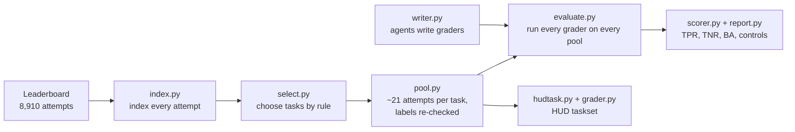

# How Verifier Bench works, end to end

This walks through the code in the order the data flows: from the public leaderboard to a score for every
agent-written grader, and then to the HUD taskset. Each section says what the stage is for, what the code does,
and what went wrong while building it.

## The shape of it

**Where things run.**
- **The repo** (`/Users/anilkumar/verifier_bench`) is the code. `tools/sync.sh` copies it to the server.
- **The server** (Hetzner, `root@178.156.248.194`) does the heavy work: downloads, Docker builds, regrading, the
  writer agents. Its data lives in `/root/vbench` (pools, writer tasks, graders, caches, runs).
- **HUD** hosts the taskset. It's published from the Mac, where the HUD CLI is logged in.

**The tool underneath.** Terminal-Bench 4.0 tasks are **Harbor** task folders:
- `task.toml` holds the settings;
- `instruction.md` is what the solver reads;
- `environment/` is the solver's machine;
- `tests/` is the grader;
- `solution/` is the reference answer.

Harbor runs agents on them and re-grades recorded attempts. Every Terminal-Bench 4.0 task grades in a
**separate** container, which receives only the files the task declares as **artifacts** (for example
`/app/output/erp_writeback.sql`). That separation is what makes the whole design possible: a grader sees
exactly those files, so we can hand a stored attempt's files to any grader we like.

---

## Stage 1. Index every leaderboard attempt (`vb/index.py`)

**Purpose.** We need attempts whose correct verdict is already known. The public Terminal-Bench 4.0
leaderboard is exactly that: every agent run's attempts, each graded by the task's official human-written
tests.

**Code.**
- `build_index()` calls Harbor's hub commands through `util.harbor_json`:
  - `hub leaderboard show` to list the 27 leaderboard rows;
  - `hub leaderboard row trial list` and `hub trial show` to find each row's job;
  - `hub job trials` to page through every attempt in that job.
- `attempts()` flattens this into one record per attempt: task, reward, error, model, agent, job.
- The result is cached in `/root/vbench/meta/tb4_index.json`: 8,910 attempts (3,567 pass, 5,155 fail, 188
  errored). Only metadata is fetched here; nothing is downloaded yet.

---

## Stage 2. Choose tasks by rule (`vb/select.py`)

**Purpose.** Pick tasks without cherry-picking, and keep out tasks whose official tests are known to be wrong,
because a wrong "trusted grader" would make the benchmark wrong.

**Code.** `reasons_to_reject()` lists every reason a task is unusable:
- fewer than 10 passing or 10 failing attempts;
- needs a GPU;
- the grader isn't separate;
- files come from other containers;
- multi-container environment;
- a grader timeout over 900 s;
- **an open public report of a test problem.** These are listed by hand, with GitHub issue links, in
  `configs/excluded_tasks.json`.

`select()` then takes the eligible tasks and spreads the pick across categories, ordering categories by their
strongest pool. Output: `configs/m1.json`, which records the 5 chosen tasks and every rejected task with its
reasons (28 were eligible, 15 excluded for reported test problems).

---

## Stage 3. Build the pools (`vb/pool.py`)

**Purpose.** For each task, a set of real attempts with known verdicts, mixing correct and wrong, and weighted
toward **near misses** (wrong attempts that pass most checks), because those are what a good grader must catch.

**Code.**
- `build_pool(task)`:
  - **correct attempts:** 10 passing attempts, taken round-robin across leaderboard runs
    (`round_robin`), so no single agent dominates. At least 4 different runs are required.
  - **wrong attempts:** it downloads 24 failing candidates, reads how many official test cases each passed
    (`ctrf_counts`, from the attempt's test report), and calls it a **near miss** if it passed at least 80%
    (`classify_fail`). The 10 wrong attempts are taken near misses first.
  - **two runs of our own:** Harbor's `oracle` agent (the task's reference solution, which should pass) and
    `nop` (does nothing, which should fail).
  - `_download` fetches each attempt with `harbor hub trial download`. Its folder holds the artifact files the
    grader will see.
- `check_labels(task)`: **re-grades the whole pool with the official tests**, offline, through the same route
  as everything else. An attempt is kept only if its label reproduces. Result: 106 of 110 kept.
- `kept_job(task)`: assembles the kept attempts into one Harbor job folder that the regrader can replay.

**Problem found.** Harbor can't download a whole job whose name contains `/`, which every leaderboard job does.
**Fix:** download attempts one by one and write the job's `config.json` ourselves (`_job_config`).

---

## Stage 4. A copy of a task with a different grader (`vb/taskdir.py`)

**Purpose.** To score any grader, we need "this task, but graded by *that* `tests/` folder".

**Code.** `make_verifier_task(task_dir, tests_dir, out_dir, image)` copies the task, replaces `tests/`, and
rewrites `task.toml`:
- `set_verifier_offline()` sets `[verifier] network_mode = "no-network"`, so no grader, including the
  official one, can fetch anything while grading. That matters because the official tests are public on
  GitHub.
- `pin_verifier_image()` / `unpin_verifier_image()` control which Docker image the grader runs in.

**The most important bug in the project was caught here.** Terminal-Bench's published task files pin a
**prebuilt grading image that already contains the official tests**. A swapped-in `tests/` folder was silently
ignored: an "always fail" grader scored 1.0. Every agent grader would have been replaced by the human one, and
every result would have looked perfect. It was caught by the **swap proof** (`tools/swap_proof.py`): grade
one real attempt with always-pass and always-fail and require the verdicts to differ. **Fix:** remove that pin,
and point the task at an image we build ourselves (stage 5).

---

## Stage 5. Regrade recorded attempts (`vb/regrade.py`)

**Purpose.** Given a grader folder and a pool, return each attempt's reward under that grader.

**Code.**
- `build_image(tests_dir)`:
  - builds the grader's own Dockerfile with `docker build`, with network, since build time is when
    installs happen;
  - tags the image by a **hash of the folder's contents** (`tests_hash`), then adds a thin layer that clears
    any `ENTRYPOINT`;
  - returns `None` if the build fails, and then every attempt counts as an error for that grader.
- `grade(job_dir, task_dir, tests_dir, work, name)` builds the image, makes the task copy pinned to it (stage
  4), and calls `run_regrade`, which runs `harbor job regrade` offline. `read_rewards` reads each attempt's
  reward back.
- `verdict(reward)`: 1.0 is `pass`, anything lower is `fail`, and no reward is `error`.
- `infra_failures()` recognises failures that belong to the machine, not the grader (for example Docker
  running out of networks), so they are retried rather than scored.

**Problems found, and fixes:**
- **Stale build.** Harbor's own build reused stale files when two grader folders had files of the same
  size and timestamp, so one grader's verdicts came from another. **Fix:** we build every image ourselves,
  tagged by content hash.
- **Misleading network probe.** Harbor's offline mode works through a sidecar that accepts every TCP
  connection locally and then refuses to forward it, so "the connection succeeded" proved nothing. **Fix:**
  the network probe (`templates/baselines/network_probe/`; `templates/netprobe/` is the task that proved it) requires an actual HTTP reply from GitHub. It answers 1 with the
  network open and 0 offline, and both were shown.
- **ENTRYPOINT.** One agent's grader set an `ENTRYPOINT` that ran its tests at container start, so Harbor
  couldn't run them. **Fix:** the clearing layer in `build_image`, plus reworded instructions.
- **Address pool.** Docker's default pool of about 30 networks ran out under load. **Fix:** detect the
  infrastructure failure, prune networks, retry (stage 7), lower concurrency, and clean up containers from
  stopped runs.

---

## Stage 6. The agents write graders (`vb/writer.py`, `vb/leakscan.py`)

**Purpose.** Produce the graders being measured, under controlled conditions.

**Code.**
- `WRITERS`: two models × two harnesses:
  - Sonnet 5 in Claude Code and in terminus-2;
  - GPT-6 Luna in Codex and in terminus-2.

  Each entry holds the Harbor agent name, model id, and settings (money cap, turn cap, no web tools). All
  model calls go through the HUD gateway (`inference.hud.ai`).
- `make_writer_task(task_dir, variant)` turns a Terminal-Bench task into a **writer task**:
  - the same `environment/`, so the writer sits on the solver's starting machine;
  - an `instruction.md` built from a template that embeds the original task text (with the benchmark's canary
    line removed, `_without_canary`) and lists the artifact paths the grader will receive;
  - network restricted to the model gateway;
  - the artifact `/verifier_out/`.
- `VARIANTS`:
  - `v1`: the basic instruction, 30 minutes;
  - `v2`: the "+protocol" instruction (list requirements, one check per requirement, build your own correct
    and flawed solutions and prove the grader on them), 90 minutes.
- `run_writer(writer, …)` runs `harbor run` with that agent. The HUD key goes to the container, or only to the
  host process for terminus-2, which drives the machine from outside.
- `collect(job_dir, writer)` copies each finished grader to `/root/vbench/verifiers/<writer>/<task>/<attempt>/`
  and runs the leak scan.
- `leakscan.scan()` flags any grader file byte-identical to an official test file (except task inputs), and
  any text that fetches from GitHub, Hugging Face or a Terminal-Bench image other than the task's own
  environment image.

**Problems found, and fixes:**
- **Luna couldn't be reached.** The gateway serves Luna only on OpenAI's Responses API. **Fix:** route through
  LiteLLM's `openai/responses/` prefix.
- **Leak-scan false alarms.** Graders that copied the task's own input firmware, or referenced their
  environment image (even with a mistyped digest), were flagged. **Fix:** exempt task inputs and the
  environment image.
- **Canary marker.** The instruction carried the benchmark's canary marker, which would have made copying the
  instruction look like a leak. **Fix:** strip it.

---

## Stage 7. Score everything (`vb/evaluate.py`, `vb/scorer.py`, `vb/report.py`)

**Purpose.** Run every grader on every pool with the controls, and produce the numbers.

**Code.**
- `verifiers_for(task)` lists everything to grade: the **original** tests, the controls (`always_pass`,
  `always_fail`, `network_probe`, from `templates/baselines/`), and every writer grader.
- `cached_grade()` grades one grader on one pool and caches the result by (pool, grader content hash), so a
  rerun only grades new work. It retries up to 8 times on infrastructure failures, pruning Docker networks
  between attempts, and **refuses to score** if they persist.
- The trivial controls run on a small sample (`probe_job`: 2 correct and 2 wrong attempts). That's enough to
  prove the swap works and the offline rule holds. The original tests and every writer grader run on the full
  kept pool.
- `no_verifiers(task)`: a writer attempt that produced no grader is scored as rejecting everything, not
  dropped.
- `scorer.score_task(verdicts)`:
  - **TPR** is the correct attempts accepted;
  - **TNR** is the wrong attempts rejected, also split by kind (near miss, plain fail, do-nothing);
  - **BA** = (TPR + TNR) / 2;
  - **flakiness** is the share of errors. An error counts as a reject.
- `scorer.check_baselines()` is the gate on every run:
  - always-pass must score BA 0.5 (TPR 1, TNR 0);
  - always-fail must score BA 0.5 (TPR 0, TNR 1);
  - the network probe must fail everything;
  - the original tests must score BA 1.0 on the kept pool.

  If any of these fails, the run is not trusted.
- `evaluate()` writes a dated run folder (`/root/vbench/runs/m1_eval/<time>_<git sha>/`) with
  `verdicts.jsonl` (every grader × attempt), `scores.json`, and `summary.md` from `report.render`. The copies in
  the repo are `runs/m1/` (first run) and `runs/m1b/` (both runs scored together).

**Extra controls, in `tools/`:**
- `positive_control.py`: the official tests sent through **our** build route must also score about 1.0. This
  proves the route agent graders take can award a pass. It scored 1.00 on four tasks; see the uefi note below.
- `read_graders.py`: prints every grader's output on one correct and one wrong attempt, which is how the
  failure modes in the report were found by reading rather than guessing.
- `uefi_quiet_rerun.py`: uefi's official tests fail 4 correct attempts under heavy load and pass them run
  alone. It's a timing-sensitive grader, disclosed.

---

## Stage 8. The HUD taskset (`vb/hudtask.py`, `templates/hud/`, `tools/hud_*`)

**Purpose.** Turn the benchmark into a HUD task where **writing the grader is the task** and the reward is how
well it grades.

### Building a task (`vb/hudtask.py`, run on the server)

`build_task(task)` produces a Harbor task folder, `/root/vbench/hud_tasks/write-verifier-<task>/`:
- **`environment/`:** the task's own environment. The agent works on the solver's starting machine, with no
  network.
- **`instruction.md`:** from `templates/writer_instruction_hud.md`. The task text, the artifact paths, and the
  **grading image's Dockerfile** (`grading_dockerfile()`: the official one with the canary and the lines that
  copy the official tests removed).
- **`tests/`:** the hidden grader's image:
  - `Dockerfile`: starts `FROM` the task's official grading image, deletes the official tests, installs
    `bubblewrap` (and `python3` if missing), and copies in the grader and the pool;
  - `grader/pool/`: the kept attempts' artifact files under **random ids**, in shuffled order
    (`build_pool()`), with `manifest.json` holding only (id, label);
  - `grader/config.json`: the artifact paths, the per-attempt timeout (the official one), and the image's
    environment variables and working directory (`image_config()`, read with `docker image inspect`).
- **`solution/`:** the official tests. Harbor uses it only for its `oracle` agent, and HUD never packages it.
- **`task.toml`:**
  - one HUD compute profile for the whole container (`HUD_PROFILES`);
  - a grading timeout of pool size × per-attempt timeout + 300 s;
  - no network for agent or grader.
- The map from random id back to the leaderboard attempt goes to `/root/vbench/hud_pool_keys/`, **outside**
  the task folder, so no image can carry it.

### The hidden grader (`templates/hud/grader.py`)

When the agent finishes, HUD collects `/verifier_out` and runs `/tests/test.sh`, which runs
`python3 /grader/grader.py`. The grader:
1. Marks itself non-dumpable, so no other process can read its memory, then loads the config and labels.
2. If there is no `/verifier_out/tests/test.sh`, it scores every attempt as rejected, giving reward 0.
3. **Probes for a sandbox** (`probe()`). It runs a small script inside the nested sandbox that checks `/grader`
   looks empty and that no visible process exposes it through `/proc/<pid>/root`. It tries a fresh `/proc`
   first (`procfs`), then shares the platform's read-only (`bindproc`). **If neither passes, it refuses to
   grade**: exit 1, no reward, which HUD records as an error rather than a score.
4. For each attempt in the pool (`run_one()`):
   - copies the agent's tests and fresh copies of the directories tests write to (the artifacts' top-level
     directories, `/root`, `/home`) into a staging folder, and places the attempt's artifact files;
   - runs `bash /tests/test.sh` with a per-attempt timeout, inside a nested **bubblewrap** sandbox
     (`bwrap_argv()`) that has:
     - the grading image read-only;
     - `/grader` and `/verifier_out` replaced by empty directories;
     - fresh `/tmp` and `/run`;
     - its own user, process, network, IPC and hostname namespaces;
     - **all capabilities dropped**;
     - a clean environment;
   - reads the verdict (`verdict_of()`): only a reward of exactly 1 is a pass. Anything else, including a
     timeout or no verdict, is a reject;
   - kills everything the run started, and deletes the staging folder.
5. Scores it (`score()`) and writes `reward.txt`:

       reward = max(0, 2 × BA − 1)

   It prints a JSON summary (BA, TPR, TNR, per-attempt verdicts and labels, sandbox mode, timings) that
   appears in the HUD trace.

### Checking and publishing (`tools/hud_local_check.sh`, `tools/hud_publish.py`)

- **`hud_local_check.sh <task>`** (server, Docker) builds the grading image and hands it five graders:
  - the official tests, which must score 1;
  - always pass, always fail, nothing, and a **cheating grader** (`templates/hud/checks/cheat/`), which must
    all score 0. The cheating grader tries every route to the hidden answers we know of and accepts if any
    works.
- **`hud_publish.py --task <task>`** (Mac):
  1. copies the task from the server;
  2. makes a **check copy** with the five graders built into the writer's machine;
  3. runs HUD's adapter (`hud.integrations.harbor.adapt`) and deploys it (`hud deploy` with the adapter's
     runtime config);
  4. runs one row per grader on HUD with a cheap model told to copy that grader into place (`hud eval
     --remote`), and requires official 1 and everything else 0;
  5. only then adapts, deploys and syncs the real task into the `verifier-bench` taskset (`hud sync tasks`).

### Problems found building it, and fixes

| problem | how we found it | fix |
|---|---|---|
| On HUD the grading image is built at deploy time, so the agent's own Dockerfile can't be built | Reading HUD's adapter source | The agent's tests run in the official grading image, which the instruction shows it; disclosed as a contract change |
| The grader and the agent's tests share one user inside HUD's sandbox, so file permissions hide nothing | Reading the adapter's sandbox code | A nested sandbox per run, with the answers hidden by mounts; refuse to grade without it |
| Debian's bubblewrap (0.8) has no overlay mounts | First sandbox test | A read-only image plus fresh private copies of the writable directories |
| This server's kernel policy blocks nested sandboxes from an unprivileged process | Local test | Local checks grant the grader container the needed rights; HUD itself allows nesting, which we proved on HUD |
| HUD, like Docker, refuses a fresh `/proc` inside the nested sandbox | The first HUD check's trace | Share the platform's `/proc` read-only, after the probe proves nothing leaks through it |
| The cheating grader "won" twice, both times on a check of mine that wasn't a leak (matching a folder name in a command line) | Diagnostic runs inside the sandbox, one check per line | Fixed the cheating grader's checks; every real route stays blocked |
| HUD's hosted runtime accepts only fixed compute sizes (2 CPU / 4 GB is not one) | First HUD run: "runtime pricing is not configured" | Map each task to a listed profile: 4 CPU / 8 GB, or 16 CPU / 16 GB for uefi |
| A grader section with its own resources made HUD grade on a fresh machine, without the agent's files ("session files are unavailable") | Diffing a working and a failing task row | One size for the whole container; the publish script refuses a grader row with its own runtime config |

---

## Tests (`tests/`)

40 unit tests, run with `.venv/bin/python -m pytest -q`:
- `test_taskdir.py`: offline rewrite, pin and unpin, refusing unsafe copies;
- `test_regrade.py`: reward reading, verdicts, content hashing, infrastructure-failure detection;
- `test_pool.py`: round-robin, near-miss classification;
- `test_select.py`: rejection rules;
- `test_scorer.py`: TPR, TNR, BA and the baseline gate;
- `test_writer.py`: writer tasks and variants;
- `test_report.py`: rendering;
- `test_util.py`: paths, JSON and run folders;
- `test_hudtask.py`:
  - the HUD grader's verdict parsing (only exactly 1 passes);
  - reward = 0 for always-pass and always-fail and 1 for perfect;
  - the sandbox arguments hide `/grader` and drop capabilities;
  - the grading Dockerfile shown to the agent has no copy of the official tests.

## Running it end to end

On the server, from `/root/vbench/repo` (after `tools/sync.sh`):

    python3 -m vb.index                                # stage 1
    python3 -m vb.select --n 5                         # stage 2 -> configs/m1.json
    python3 -m vb.pool --task <task>                   # stage 3, per task
    python3 -m vb.writer --make [--variant v2]         # stage 6: writer tasks
    python3 -m vb.writer --run <writer> --attempts 1   # stage 6: run one writer
    python3 -m vb.evaluate                             # stage 7
    PYTHONPATH=. python3 tools/swap_proof.py           # the swap proof
    PYTHONPATH=. python3 tools/positive_control.py     # official tests through our route
    python3 -m vb.hudtask --task <task>                # stage 8: build the HUD task
    bash tools/hud_local_check.sh <task>               # stage 8: local check

On the Mac, with the HUD CLI logged in:

    python tools/hud_publish.py --task <task>          # check on HUD, then publish
